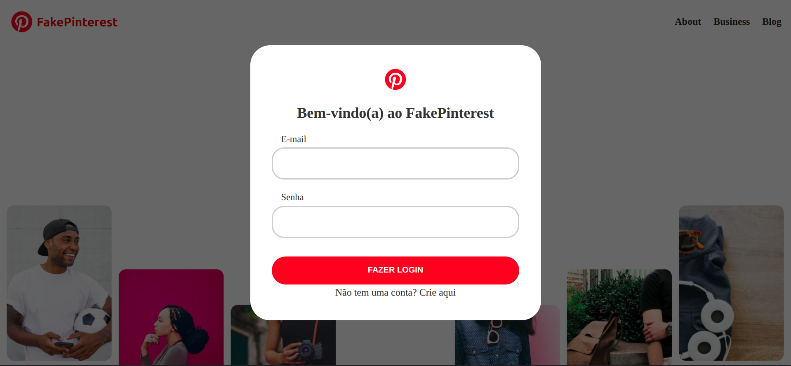
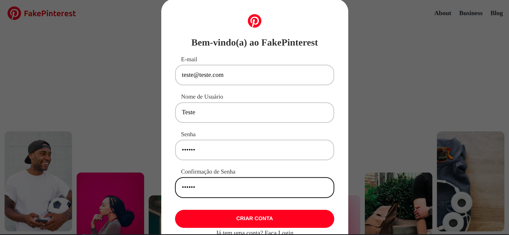
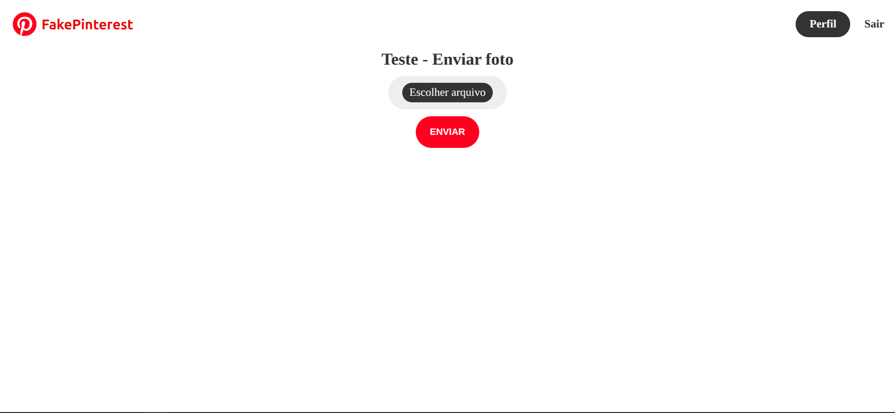
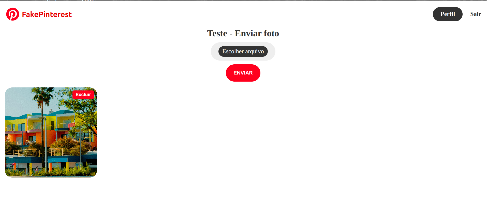
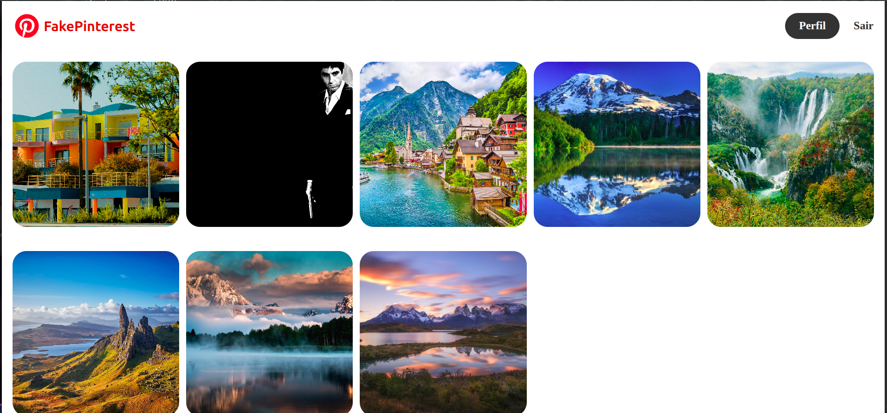
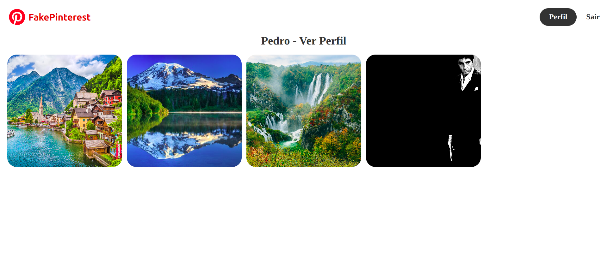

# Rede Social de Fotos (Clone do Pinterest) - Flask

Clone do site da rede social de fotos Pinterest, utilizando o framework Flask.

---

## Demonstração

| Página Inicial | Página de Criação de Conta |
| :---: | :---: |
|  |  |

| Página de Perfil | Página de Perfil Após Envio de Foto |
| :---: | :---: |
|  |  |

| Página Inicial das Fotos | Página de Perfil de Outro Usuário |
| :---: | :---: |
|  |  |

---

## Tecnologias

Este projeto foi desenvolvido utilizando as seguintes tecnologias:

- **Python 3.12.3**
- **HTML5**
- **Flask (Criação de páginas da internet)**
- **WTForms (Autenticação de usuários)**
- **SQLAlchemy (Criação de banco de dados)**

---

## Funcionalidades

- [x] Criação e autenticação de usuários
- [x] Postagem de fotos
- [x] Exclusão de fotos postadas
- [x] Visualização de fotos postadas por qualquer usuário
- [x] Visualização de perfil de qualquer usuário

---

## Estrutura de Dados

O projeto conta com um arquivo `comunidade.db`, na pasta `instance`, contendo exemplos de usuários e fotos postadas para permitir o teste do site, bem como a criação e armazenamento de informações de novos usuários e posts de fotos. As senhas são armazenadas após criptografia, tornando o banco de dados seguro. Todos os usuários foram criados usando e-mails fictícios.

---

## Como Executar o Projeto

### Pré-requisitos

Antes de começar, você precisará ter instalado em sua máquina:
- [Git](https://git-scm.com)
- [Python 3.12](https://www.python.org/)

### Passo a Passo

1. **Clone este repositório:**
   ```bash
   git clone https://github.com/Brazil25/fakepinterest
   ```

2. **Acesse a pasta do projeto:**
   ```bash
   cd fakepinterest
   ```

3. **Crie e ative o ambiente virtual (opcional, mas recomendado):**
   ```bash
   python -m venv .venv
   source venv/bin/activate  # Linux/Mac
   # ou: venv\Scripts\activate  # Windows
   ```

4. **Instale as dependências:**
   ```bash
   pip install -r requirements.txt
   ```

5. **Execute a aplicação:**
   ```bash
   python main.py
   ```

6. **Acesse o link:**
   - Acesse o link de desenvolvimento gerado pelo Flask para ter acesso à página da rede social e todas as suas funcionalidades.

---

## Licença

Este projeto está sob a licença MIT.
